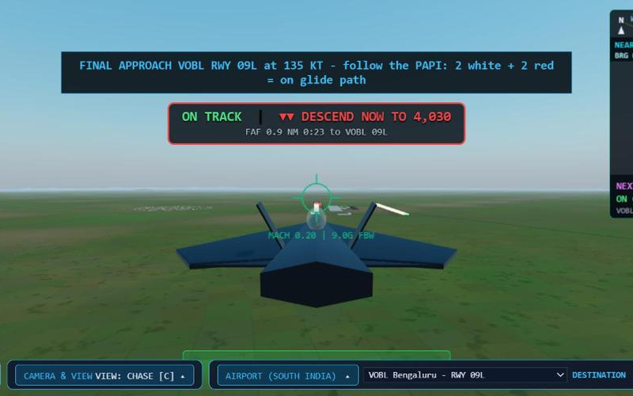

# SkyForge

A 3D flight simulator over real South India terrain: four aircraft (trainer, cargo transport, stealth fighter,
helicopter), 29 real airports with runway lights and PAPI, routes between airports with a NAV autopilot, ILS
approaches, wind and monsoon rain, a fighter weapons range, two players on one screen (two PS5 pads), colour-coded
track guidance with terrain / stall / bank warnings, and a full crash sequence (eject, parachute, fire, debris).

- Play: open `index.html` through any local web server (`python -m http.server`), or on stratos.games.
- Everything is inside the folder: Three.js 0.160.0 and its add-ons are bundled in `vendor/three/` (MIT, see its LICENSE).
- Analytics: only the shared Stratos script (`track()` in `index.html`): `level_start` when a flight leaves the
  ground, `level_complete` on a good landing, `game_over` on a crash, with the seconds flown. No personal data.
- Terrain: SRTM, GMTED2010, ETOPO1 via Mapzen Terrain Tiles (AWS Open Data); airports: OurAirports (public domain).
